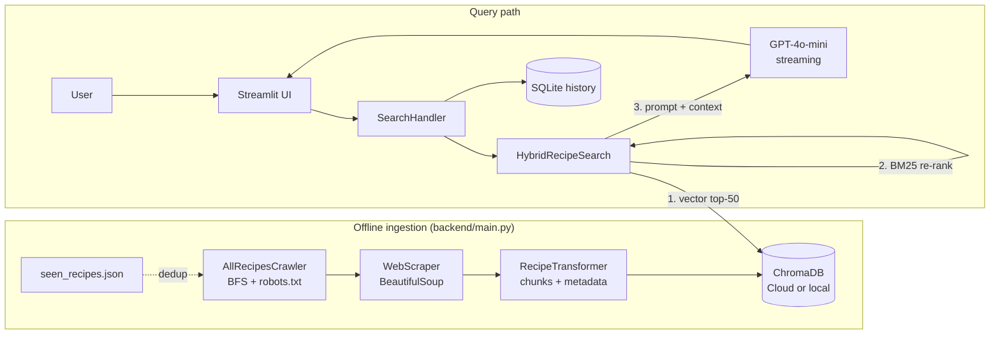

# Recipier — Architecture One-Pager

**What it is:** An AI recipe search engine. Users ask natural-language questions ("what can I make with spinach and chicken?"); the system retrieves relevant recipes scraped from AllRecipes and has GPT-4o-mini write grounded, step-by-step guidance. Classic **RAG** (Retrieval-Augmented Generation).

**Pitch:** An offline pipeline crawls and chunks recipes into ChromaDB. At query time, hybrid retrieval (vector search + BM25 re-ranking) finds the best chunks, which are grouped by recipe and fed to GPT-4o-mini. The answer streams back to a Streamlit UI, and history is stored in SQLite.

## Components

| Layer | Where | Key idea |
|---|---|---|
| Crawl | `scraper/WebCrawler.py`, `AllRecipesWebCrawler.py` | BFS, cached robots.txt, request delay; subclass overrides link filter |
| Parse + chunk | `scraper/WebScraper.py`, `RecipeTransformer.py` | One chunk per title / ingredient section / direction step / nutrition fact, with metadata |
| Store | `backend/database.py` | Factory: Chroma Cloud if env vars set, else local `PersistentClient` |
| Retrieve | `backend/search.py` | Semantic top-50, then BM25 on those candidates, then weighted fusion (0.7 / 0.3) |
| Generate | `backend/search.py` | Context grouped by recipe; "Chef AI" prompt with grounding rules; streamed events |
| UI | `frontend/` | Streamlit components, `StateManager`, `SearchHandler` (backend runs in-process) |
| History | `frontend/database/history.py` | SQLite: past queries and full responses |
| Multimodal (WIP) | `backend/imagebind_embeddings.py`, `migrate_to_imagebind.py` | ImageBind puts text, image, and video in one 1024-dim space; not yet wired to UI |

## Key design decisions

- **Hybrid search:** vectors capture intent and synonyms; BM25 rescues exact terms (e.g. "Indonesian") that pure semantic search missed.
- **Re-rank only the candidates:** BM25 over 50 docs instead of ~20k chunks keeps latency low.
- **Fine-grained chunks:** precise matches and fewer LLM tokens; metadata lets the context formatter rebuild whole recipes.
- **Streaming:** low time-to-first-token improves perceived speed.
- **Env-based client factory:** same code runs locally and in production.

## Known limitations and next steps

1. **Not truly parallel hybrid:** keyword-only matches outside the semantic top-50 are never found. Fix: run both retrievers independently and merge with Reciprocal Rank Fusion.
2. **Unused full BM25 index:** `_ensure_bm25_index()` rebuilds over all documents hourly, but `hybrid_search` only uses the per-query mini index.
3. **Relative normalisation:** `1 - d/d_max` always zeroes the weakest candidate, so scores aren't comparable across queries.
4. **Random chunk IDs (`uuid4`):** `upsert` never overwrites, which caused the duplicates. Fix: deterministic IDs (hash of URL + type + index).
5. **Shared, ephemeral history:** there's no per-user isolation, and SQLite on Streamlit Cloud isn't durable.
6. **Monolith:** FastAPI is listed in requirements but unused. Next step: a FastAPI SSE endpoint so mobile or web clients can consume it.
7. **Brittle scraper:** tied to AllRecipes CSS classes. Parsing `schema.org/Recipe` JSON-LD would be sturdier.
